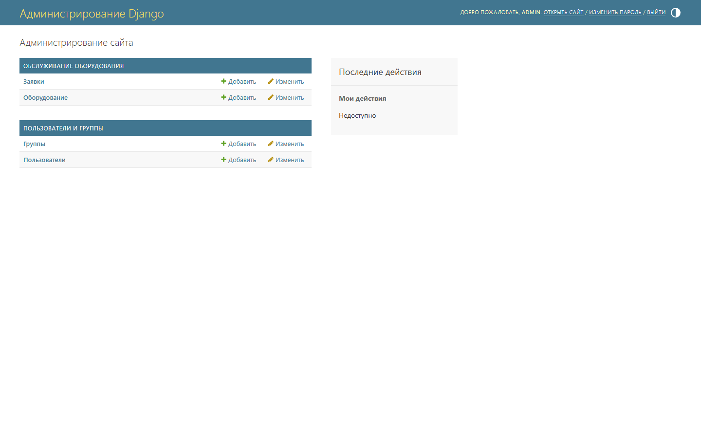
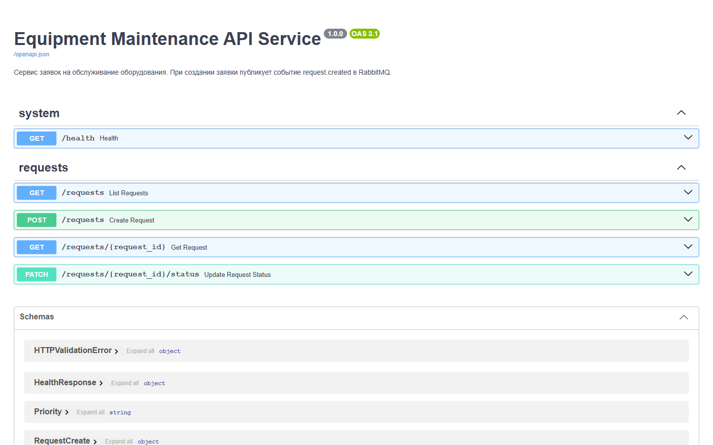

# Equipment Maintenance — учебный проект

Система заявок на обслуживание оборудования: Django/DRF backend, FastAPI-сервис
приёма заявок, RabbitMQ для событий и MongoDB для журнала аудита.

## Структура

```text
django_project/          Django backend + DRF API + аудит в MongoDB
  maintenance/
    serializers.py       сериализаторы с валидацией
    views.py             ViewSet + router
    audit.py             запись событий в audit_events
api_service/             FastAPI-сервис
  main.py                GET /health, GET/POST /requests
  schemas.py             Pydantic-модели RequestCreate и др.
  events.py              формирование и публикация событий
  consumer.py            consumer очереди maintenance_requests
  Dockerfile             образ FastAPI-сервиса
async_demo.py            sync vs asyncio
tests/                   pytest-тесты API и событий
docker-compose.yml       fastapi + rabbitmq + mongo + django
```

## Быстрый старт (локально)

```powershell
python -m venv .venv
.\.venv\Scripts\Activate.ps1
pip install -r requirements-dev.txt
```

MongoDB и RabbitMQ нужны только для аудита и событий. Без них API работает:
аудит пишется в лог, а публикация события логируется как ошибка. Отключить
аудит можно переменной `MONGO_AUDIT_ENABLED=0`.

### Django backend

```powershell
cd django_project
python manage.py migrate
python manage.py import_equipment --demo
python manage.py runserver 8000
```

- API: `http://localhost:8000/api/equipment/`, `http://localhost:8000/api/requests/`
- Админка: `http://localhost:8000/admin/`
- Пример: `POST /api/requests/` с телом
  `{"equipment": 1, "description": "Течь масла", "priority": "high"}`

Валидация DRF: пустое описание, неизвестный `priority` и несуществующее
оборудование возвращают `400`. Смена статуса — `PATCH /api/requests/{id}/`
или `PATCH /api/requests/{id}/status/`.

### FastAPI api_service

```powershell
uvicorn api_service.main:app --reload --port 8001
```

- Swagger: `http://localhost:8001/docs`
- `GET /health` → `{"status": "ok", "service": "api_service"}`
- `GET /requests`, `GET /requests/{id}`
- `POST /requests` с телом
  `{"equipment_id": 1, "description": "Не включается шпиндель", "priority": "critical"}`
  → создаёт заявку и публикует `request.created` в очередь `maintenance_requests`
- `PATCH /requests/{id}/status` — смена статуса

```powershell
curl -X POST http://localhost:8001/requests `
  -H "Content-Type: application/json" `
  -d '{"equipment_id":1,"description":"Не включается шпиндель","priority":"critical"}'
```

### RabbitMQ consumer

```powershell
python -m api_service.consumer
```

Consumer печатает `[consumer] Заявка #1: request.created` и подтверждает
сообщение через `basic_ack` после обработки. Consumer запускается без участия
пользователя в Docker Compose.

### AsyncIO

```powershell
python async_demo.py
```

Ожидаемый результат: синхронный вариант ≈ 10 с, асинхронный ≈ 2 с.

## Тесты

```powershell
pytest
```

Покрыто: создание заявки, запрет пустого описания, поиск/получение заявки,
смена статуса, health-check FastAPI, валидация priority и оборудования,
формирование и публикация события, ack/nack consumer, структура аудита.

## Docker Compose

```powershell
docker compose up --build
```

| Сервис | Адрес | Назначение |
|---|---|---|
| `api_service` | http://localhost:8001 | FastAPI, создание заявок и публикация событий |
| `django` | http://localhost:8000 | Django backend + DRF + админка |
| `rabbitmq` | http://localhost:15672 | Management UI (guest/guest), очередь `maintenance_requests` |
| `mongo` | localhost:27017 | Коллекция `audit_events` |
| `consumer` | — | Слушает очередь и подтверждает сообщения |

Проверка сквозного сценария после `docker compose up`:

```powershell
curl -X POST http://localhost:8001/requests `
  -H "Content-Type: application/json" `
  -d '{"equipment_id":1,"description":"Проверка события","priority":"medium"}'

docker compose logs -f consumer
# [consumer] Заявка #1: request.created
```

Проверка аудита MongoDB:

```powershell
docker compose exec mongo mongosh equipment_maintenance `
  --eval "db.audit_events.find().sort({created_at:-1}).limit(5).toPretty()"
```

Суперпользователь создаётся один раз — база SQLite хранится в volume
`django_data`, поэтому админ и данные переживают пересборку контейнера:

```powershell
docker compose exec django python manage.py createsuperuser
```

Удаление `docker compose down -v` стирает volume вместе с базой, и админа
нужно создать заново.

## Доказательства запуска

Скриншоты работающих сервисов:

- [Админка Django](docs/screenshots/01_django_admin.png)
- [Список заявок в админке](docs/screenshots/02_django_admin_requests.png)
- [Корень DRF API](docs/screenshots/03_drf_api_root.png)
- [Заявки через DRF](docs/screenshots/04_drf_requests.png)
- [Swagger FastAPI](docs/screenshots/05_fastapi_swagger.png)
- [GET /health](docs/screenshots/06_fastapi_health.png)
- [GET /requests](docs/screenshots/07_fastapi_requests.png)
- [POST /requests](docs/screenshots/08_fastapi_post_request.png)

Текстовые результаты:

- [pytest — 24 passed](docs/evidence/pytest.txt)
- [async_demo — 10.00 с против 2.00 с](docs/evidence/async_demo.txt)
- [Smoke-проверка FastAPI](docs/evidence/api_smoke.txt)




